# pbo2-2410010086

## P01 – Pengenalan PBO 2

### 1. Hasil Keluaran Program

#### a. Program HaloPBO2

Program `HaloPBO2` dibuat sebagai latihan awal untuk menampilkan keluaran program Java.

**Screenshot keluaran program:**

#### b. Program KartuMahasiswa

Program `KartuMahasiswa` dibuat untuk menampilkan informasi kartu mahasiswa melalui program Java.

**Screenshot keluaran program:**

### 2. Riwayat Commit Git

Riwayat commit digunakan untuk melihat perubahan yang telah disimpan pada repository.

**Screenshot hasil perintah `git log --oneline`:**

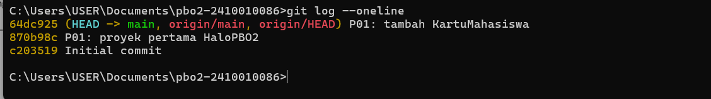

Screenshot menunjukkan riwayat commit repository dengan minimal dua commit.

## P02 – Perpustakaan Mini

### 1. Hasil Keluaran Program

#### a. Pencarian dan peminjaman Buku Skripsi 

Screenshot berikut menunjukkan keluaran program ketika melakukan pencarian buku dengan judul `Skripsi`.

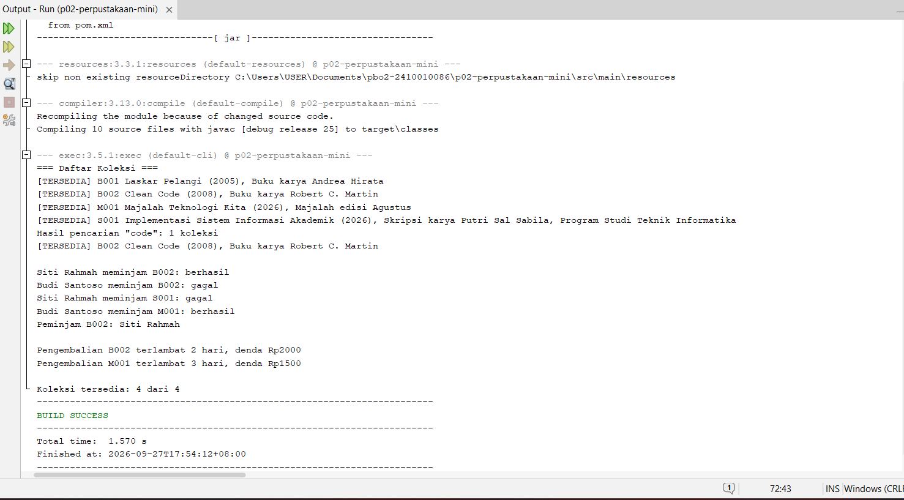

### 2. Jawaban Eksperimen Praktikum 6

#### Eksperimen 1
Jawaban: [Terjadi error karena Koleksi merupakan abstract class, sehingga tidak dapat dibuat objek secara langsung menggunakan new. Koleksi harus diturunkan terlebih dahulu oleh class seperti Buku atau Majalah.]

#### Eksperimen 2
Jawaban: [Jika @Override masih ada, akan terjadi error pada compiler karena hitungdenda tidak sama dengan method hitungDenda yang ada pada interface. Jika @Override dihapus, error anotasi memang hilang, tetapi class Buku tetap tidak memenuhi method hitungDenda dari interface, sehingga tetap bermasalah.]

#### Eksperimen 3
Jawaban: [Saat program dijalankan, akan terjadi IllegalArgumentException dengan pesan "Judul tidak boleh kosong", karena constructor Koleksi melakukan validasi bahwa judul koleksi tidak boleh kosong.]

#### Eksperimen 4
Jawaban: [Hal tersebut melanggar encapsulation dan aturan bisnis peminjaman, karena status koleksi dapat diubah langsung dari luar class tanpa melalui method pinjam() atau kembalikan(). Seharusnya perubahan status dikendalikan oleh class Koleksi.]

## P03 – Komponen GUI

### 1. Hasil Form Pemesanan Tiket Travel

#### a. Tema Terang

Screenshot berikut menunjukkan tampilan Form Pemesanan Tiket Travel saat dijalankan menggunakan tema terang.

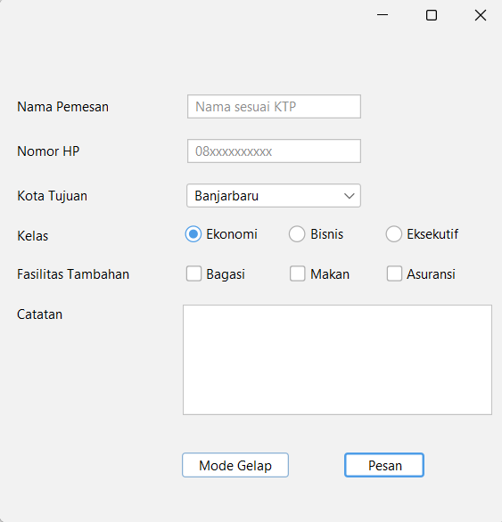

#### b. Tema Gelap

Screenshot berikut menunjukkan tampilan Form Pemesanan Tiket Travel saat dijalankan menggunakan tema gelap.

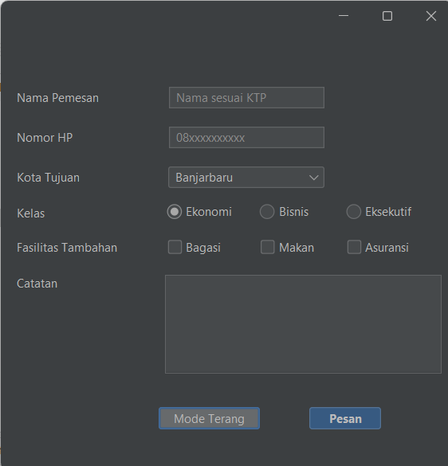

### 2. Tampilan Design FormTiketTravel

Screenshot berikut memperlihatkan tab Design pada `FormTiketTravel`, termasuk jendela Navigator yang menampilkan komponen form.

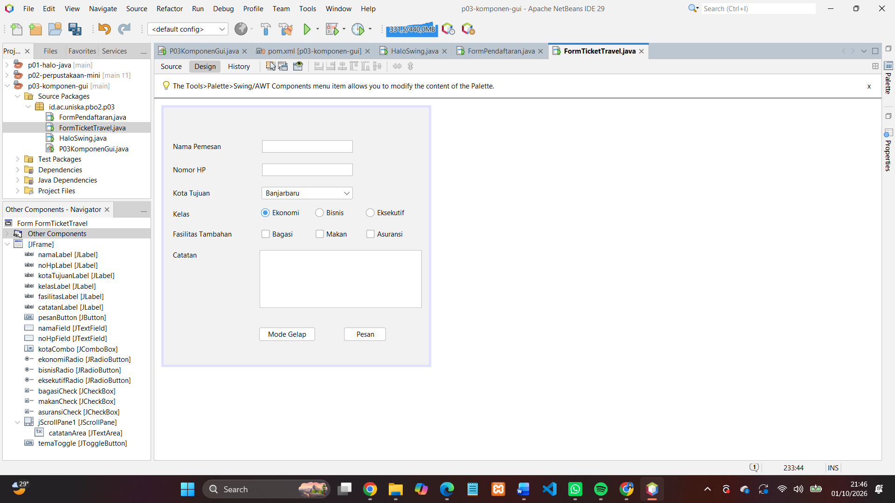

### 3. Refleksi Bagian G

**1. [Pertanyaan refleksi pertama]**

Jawaban: [Top-level container adalah wadah utama untuk menampilkan sebuah aplikasi,
contohnya JFrame. Intermediate container digunakan untuk mengelompokkan komponen
lain, contohnya JPanel. Sedangkan atomic component adalah komponen yang langsung
digunakan untuk menerima input atau menampilkan informasi, contohnya JButton atau
JLabel.
]

**2. [Pertanyaan refleksi kedua]**

Jawaban: [Karena JRadioButton yang berada dalam ButtonGroup yang sama hanya dapat
memilih satu pilihan pada satu waktu. Contohnya pada pilihan jenis kelamin, pengguna
hanya bisa memilih Laki-laki atau Perempuan, bukan keduanya sekaligus.]

**3. [Pertanyaan refleksi ketiga]**

Jawaban: [JComboBox lebih cocok digunakan ketika pilihan yang tersedia cukup banyak
sehingga lebih hemat tempat, misalnya pilihan program studi atau kota tujuan. Sedangkan
JRadioButton lebih cocok jika pilihannya sedikit dan ingin ditampilkan langsung, seperti
pilihan kelas tiket Ekonomi, Bisnis, dan Eksekutif.]

**4. [Pertanyaan refleksi keempat]**

Jawaban: [Karena initComponents() merupakan kode yang dibuat otomatis oleh GUI Builder
NetBeans. Jika diedit langsung, perubahan bisa tertimpa ketika tampilan diubah melalui tab
Design. Kode tambahan seperti event dan method dapat ditulis di luar blok initComponents(), misalnya pada constructor, event handler, atau method bantuan.]

**5. [Pertanyaan refleksi kelima]**

Jawaban: [Karena FlatLightLaf perlu dipasang terlebih dahulu agar tampilan komponen Swing
menggunakan tema FlatLaf sejak awal form dibuat. Jika dipanggil setelah form dibuat,
tampilan awal form bisa belum menggunakan tema yang diinginkan.]

## P04 – Layout Manager dan Desain Form

### 1. Hasil Praktikum

#### a. Tampilan Awal Form

Screenshot berikut menunjukkan tampilan awal form sebelum diperlebar.

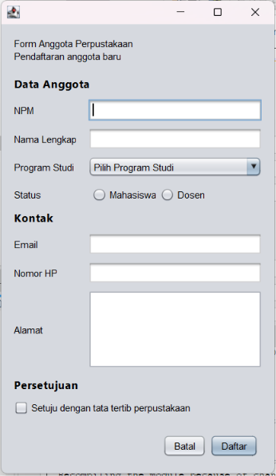

#### b. Tampilan Form Setelah Diperlebar

Screenshot berikut menunjukkan tampilan form setelah ukurannya diperlebar.

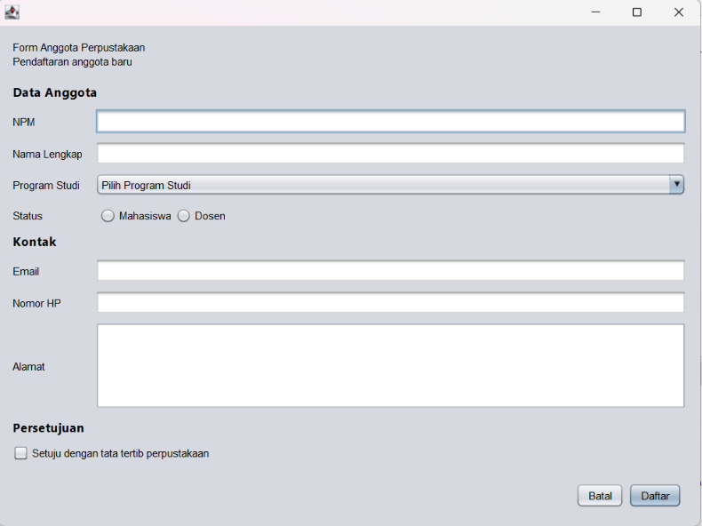

### 2. Perancangan Layout

#### a. Sketsa Tahap 1

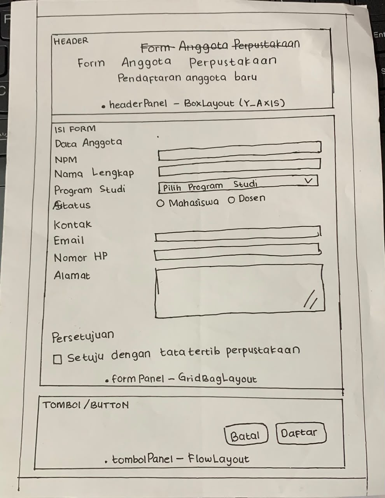

#### b. Tabel Rancangan Tahap 2

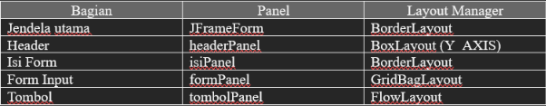

#### c. Design Navigator

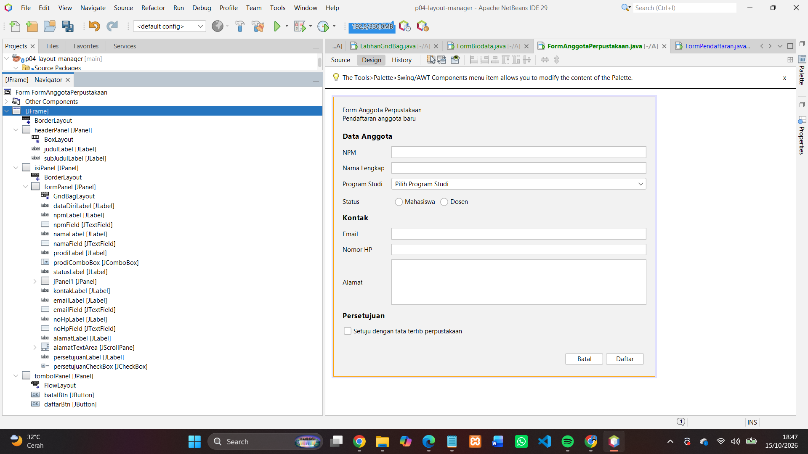

#### d. Hasil penilaian teman - Elvira Eri Saputri - 2410010461

Penilaian dilakukan untuk memeriksa tampilan Form Anggota Perpustakaan berdasarkan kriteria yang terdapat pada modul Praktikum P04. Pemeriksaan meliputi susunan label, pengelompokan isian, penggunaan placeholder, kesesuaian komponen, posisi tombol, jarak antar komponen, tampilan saat ukuran jendela berubah, serta penggunaan Layout Manager.

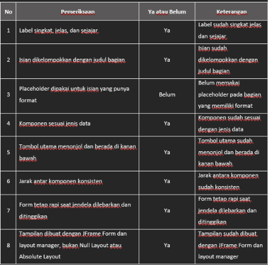

**Saran Perbaikan:**

Tambahkan placeholder pada isian yang memerlukan format pengisian agar memudahkan pengguna saat mengisi form.

### 3. Jawaban Eksperimen Praktikum 2

#### Eksperimen 1 – FlowLayout

Jawaban: FlowLayout mengatur komponen secara berurutan dari kiri ke kanan. Jika ruang pada baris tidak cukup, komponen akan berpindah ke baris berikutnya. Posisi komponen juga dapat diatur, misalnya rata tengah menggunakan `FlowLayout.CENTER`.

#### Eksperimen 2 – GridLayout

Jawaban: GridLayout membagi area menjadi baris dan kolom dengan ukuran sel yang sama. Jika jumlah baris diatur menjadi 0 dan jumlah kolom menjadi 2, komponen akan disusun dalam dua kolom. Untuk sembilan tombol, susunannya menjadi lima baris dengan satu sel tersisa pada baris terakhir.

#### Eksperimen 3 – BoxLayout

Jawaban: BoxLayout menyusun komponen secara vertikal atau horizontal sesuai arah yang ditentukan. Ukuran dan posisi komponen dapat dipengaruhi oleh ukuran komponen serta pengaturan alignment. Jarak antarkomponen dapat diatur agar tampilan lebih rapi.

### 4. Jawaban Eksperimen Praktikum 4

#### Eksperimen 1 – Weight X

Jawaban: Nilai `weightx` menentukan bagaimana ruang horizontal tambahan dibagikan kepada komponen. Jika `weightx` bernilai 0, komponen tidak mendapatkan bagian ruang horizontal tambahan berdasarkan nilai tersebut.

#### Eksperimen 2 – Posisi formPanel

Jawaban: Penempatan `formPanel` pada bagian `NORTH` membuat panel berada di bagian atas container. Jika ditempatkan pada bagian `CENTER`, panel berada di area tengah dan dapat memanfaatkan ruang yang tersedia sesuai pengaturan layout.

#### Eksperimen 3 – Minimum Size

Jawaban: Pengaturan ukuran minimum memengaruhi ukuran terkecil yang dapat digunakan oleh komponen atau panel. Jika batas ukuran minimum dihilangkan, ukuran komponen dapat menyesuaikan aturan layout dan ukuran container, sehingga tampilannya bisa berubah.

### 5. Refleksi Bagian G

**1. Apa perbedaan FlowLayout, BorderLayout, dan GridLayout?**

Jawaban: FlowLayout menyusun komponen secara berurutan dari kiri ke kanan. BorderLayout membagi container menjadi lima bagian, yaitu North, South, East, West, dan Center. GridLayout menyusun komponen dalam bentuk baris dan kolom dengan ukuran sel yang sama.

**2. Apa yang terjadi jika jumlah baris pada GridLayout diatur menjadi 0?**

Jawaban: Jika jumlah baris diatur menjadi 0, jumlah baris akan menyesuaikan jumlah komponen berdasarkan jumlah kolom yang ditentukan.

**3. Apa fungsi weightx dan weighty pada GridBagConstraints?**

Jawaban: `weightx` mengatur pembagian ruang horizontal tambahan, sedangkan `weighty` mengatur pembagian ruang vertikal tambahan kepada komponen.

**4. Mengapa pengaturan layout penting dalam pembuatan antarmuka?**

Jawaban: Pengaturan layout membantu menyusun komponen agar rapi dan teratur. Layout juga membantu tampilan menyesuaikan ukuran container sehingga antarmuka lebih mudah digunakan.

**5. Apa fungsi Design Navigator pada NetBeans?**

Jawaban: Design Navigator membantu melihat susunan komponen yang terdapat pada form. Dengan fitur ini, komponen lebih mudah ditemukan dan dipilih saat merancang antarmuka menggunakan GUI Builder.

### Deklarasi Penggunaan AI p04

Dalam pengerjaan praktikum ini, saya menggunakan AI sebagai alat bantu untuk memahami materi, mencari referensi penjelasan, dan membantu menyusun dokumentasi pada README. Seluruh proses pengerjaan dan penyesuaian program dilakukan sesuai dengan materi praktikum yang dipelajari.

# P05 — Event Handling

## 1. Tabel Pengamatan Praktikum 2

| No. | Tindakan | Event yang tercatat |
|---|---|---|
| 1 | Mengarahkan kursor ke tombol, lalu menjauhkannya | `mouseEntered` ketika kursor masuk dan `mouseExited` ketika kursor keluar |
| 2 | Mengklik tombol Klik saya | `actionPerformed` |
| 3 | Mencentang lalu menghapus centang Aktifkan fitur | `itemStateChanged` setiap kali status centang berubah |
| 4 | Mengganti pilihan dari Pagi menjadi Malam | `itemStateChanged` untuk pilihan yang berubah, termasuk status pilihan lama dan pilihan baru |
| 5 | Mengklik isian, lalu mengetik kata "abc" | `focusGained` ketika isian mendapat fokus dan `keyTyped` ketika karakter diketik |
| 6 | Mengklik tombol setelah mengetik di isian | `focusLost` ketika isian kehilangan fokus dan `actionPerformed` ketika tombol diklik |

**Catatan:** Urutan event dapat berbeda sesuai interaksi pengguna. Tabel akhir disesuaikan dengan catatan yang benar-benar muncul pada `logArea`.

Bukti tabel pengamatan:

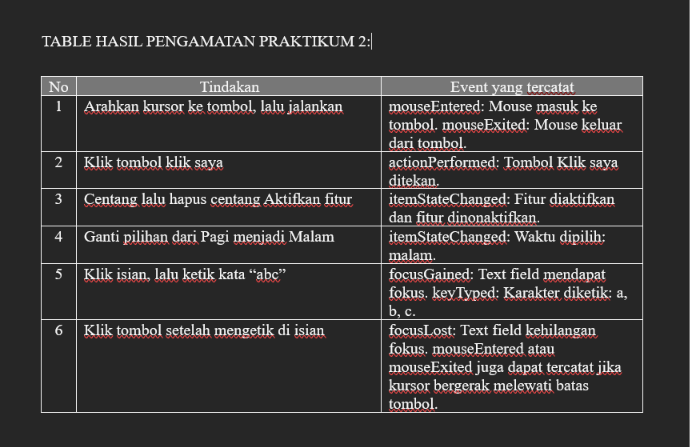

## 2. Jawaban Eksperimen Praktikum 3 — Konversi Suhu

### Eksperimen 1: Menghapus pemeriksaan `ItemEvent.SELECTED`

Jika pemeriksaan `evt.getStateChange() == ItemEvent.SELECTED` dihapus, pesan `item berubah` akan tercetak **dua kali** ketika pilihan Combo Box diganti, karena event dipanggil untuk pilihan lama yang dilepas dan pilihan baru yang dipilih.

### Eksperimen 2: Mengganti `keyReleased` menjadi `keyPressed`

Hasil terlihat terlambat satu karakter karena `keyPressed` terjadi sebelum karakter dimasukkan ke dalam teks. Akibatnya, metode `konversi()` membaca isi isian sebelum karakter terbaru ditambahkan.

### Eksperimen 3: Menghapus blok `try-catch`

Ketika huruf dimasukkan, `Double.parseDouble()` tidak dapat mengubah teks tersebut menjadi angka. Akibatnya, terjadi `NumberFormatException` dan pesan error atau stack trace ditampilkan pada jendela Output jika exception tidak ditangani.

## 3. Jawaban Eksperimen Praktikum 4 — Kalkulator Sederhana

### Eksperimen 1: Membuat event tombol kali dua kali

Jika event `actionPerformed` dibuat melalui GUI Builder sementara lambda pada konstruktor tetap digunakan, satu klik dapat menjalankan kedua listener. Pesan `kali` akan tercetak dua kali apabila perintah tersebut ditambahkan pada kedua listener.

Sebaiknya satu tombol hanya memakai satu cara penanganan event agar perhitungan tidak dijalankan berulang kali.

### Eksperimen 2: Menambahkan tombol modulus (%)

Perubahan yang dilakukan pada tab Design adalah menambahkan tombol `%` pada panel operator dan mengatur teks serta nama variabel tombol tersebut.

Pada tab Source, tambahkan event untuk tombol `%`, lalu tambahkan logika operasi modulus pada metode `hitung()`. Operasi modulus menggunakan operator `%` untuk memperoleh sisa pembagian. Contohnya, `10 % 3` menghasilkan `1`.

### Eksperimen 3: Kursor setelah tombol Hapus ditekan

Kursor langsung kembali ke isian angka pertama karena metode `hapus()` menjalankan `angka1Field.requestFocusInWindow()`. Perintah ini meminta agar isian angka pertama kembali mendapatkan fokus sehingga pengguna dapat langsung mengetik angka baru.

## 4. Peta Event Form Anggota Perpustakaan

| No. | Komponen | Event | Fungsi |
|---|---|---|---|
| 1 | `persetujuanCheckBox` | `itemStateChanged` | Mengaktifkan tombol Daftar jika persetujuan dicentang dan menonaktifkannya jika centang dihapus |
| 2 | `batalBtn` | `actionPerformed` | Mengosongkan seluruh isian, menghapus pilihan, dan mengembalikan fokus ke NPM |
| 3 | `daftarBtn` | `actionPerformed` | Menampilkan ringkasan data anggota melalui `JOptionPane` |
| 4 | `npmField` | `keyReleased` | Memperbarui jumlah digit NPM yang telah dimasukkan |
| 5 | `FormAnggotaPerpustakaan` | `windowClosing` | Menampilkan dialog konfirmasi sebelum form ditutup |

Pengaturan `defaultCloseOperation` pada form menggunakan `DO_NOTHING_ON_CLOSE` agar jendela tidak langsung tertutup sebelum pengguna memberikan konfirmasi.

## 5. Bukti Tangkapan Layar

### 5.1 Properties — Events Tombol Daftar

Screenshot berikut menunjukkan pengaturan event pada tombol Daftar di jendela Properties NetBeans.

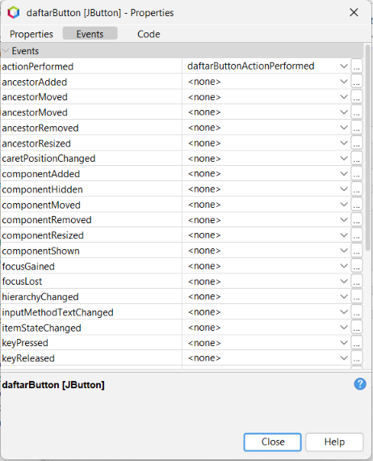

### 5.2 Dialog Ringkasan

Dialog ringkasan menampilkan data anggota yang dimasukkan melalui form setelah tombol Daftar diklik.

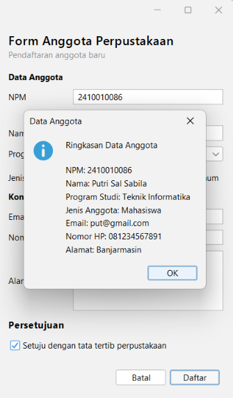

### 5.3 Dialog Konfirmasi Keluar

Dialog konfirmasi muncul ketika pengguna menekan tombol X pada jendela. Pilihan Yes digunakan untuk menutup form, sedangkan No membuat form tetap terbuka.

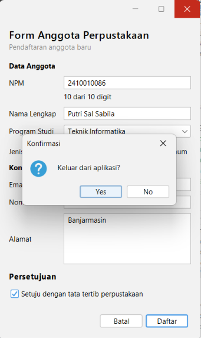

## 6. Deklarasi Penggunaan AI

Dalam pengerjaan praktikum ini, saya menggunakan **ChatGPT dari OpenAI** sebagai alat bantu untuk memahami materi event handling, memeriksa logika event pada form, membantu menyusun jawaban eksperimen, serta merapikan dokumentasi README.

Kode program, hasil pengamatan, dan tangkapan layar tetap diperiksa berdasarkan implementasi dan pengujian yang dilakukan pada aplikasi NetBeans.

# P06 – Validasi Input dan Kegunaan

## 1. Foto atau Pindaian Lembar Peer Review

Lembar peer review dari peninjau Elvira Eri Saputri:

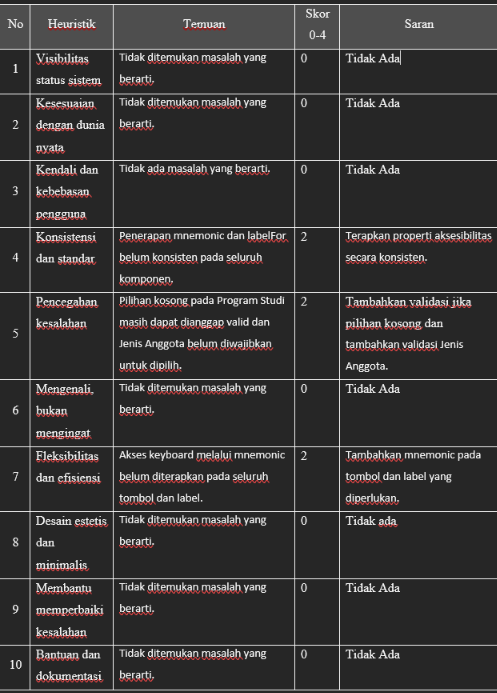

## 2. Tabel Temuan, Perbaikan, dan Commit

| Temuan dari Teman | Perbaikan yang Dilakukan | Commit |
|---|---|---|
| Penerapan mnemonic dan `labelFor` belum konsisten pada seluruh komponen. | Menambahkan mnemonic dan menghubungkan setiap label dengan komponen isian menggunakan `labelFor` secara konsisten. | Update P06: validasi input dan peer review |
| Pilihan Program Studi masih dapat dianggap valid saat kosong dan Jenis Anggota belum diwajibkan untuk dipilih. | Menambahkan validasi agar Program Studi dan Jenis Anggota wajib dipilih sebelum pendaftaran diproses. | Update P06: validasi input dan peer review |
| Akses keyboard melalui mnemonic belum diterapkan pada seluruh tombol dan label. | Melengkapi mnemonic pada tombol dan label yang diperlukan agar dapat diakses menggunakan keyboard. | Update P06: validasi input dan peer review |

## 3. Screenshot Form dengan Pesan Kesalahan

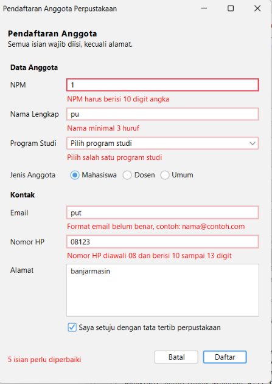

## 4. Screenshot Jendela Navigator

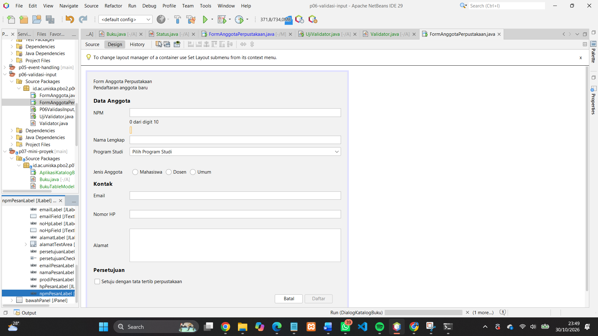

## 5. Jawaban Eksperimen Praktikum 4

**1. Ketik huruf pada isian NPM. Apa yang terjadi dan baris mana di `npmFieldKeyTyped` yang menyebabkannya?**

Huruf tidak dapat dimasukkan ke dalam isian NPM karena isian tersebut hanya menerima angka. Hal ini disebabkan oleh kondisi `!Character.isDigit(evt.getKeyChar())` yang memeriksa karakter. Jika karakter bukan angka, `evt.consume()` membatalkan input tersebut.

**2. Isi email dengan `siti@`, lalu tekan Tab. Kapan pesan kesalahan muncul?**

Pesan kesalahan muncul ketika isian email kehilangan fokus setelah tombol Tab ditekan. Hal ini terjadi karena event `focusLost` memanggil method `periksaEmail()` untuk memeriksa format email.

**3. Klik isian Nama tanpa mengetik, lalu tekan Tab. Mengapa tidak ada pesan kesalahan?**

Tidak ada pesan kesalahan karena pada event `focusLost` terdapat kondisi `if (!namaField.getText().isBlank())`. Artinya, validasi hanya dilakukan jika isian Nama tidak kosong. Isian kosong baru diperiksa ketika tombol Daftar diklik.

**4. Centang persetujuan, lalu klik Daftar dengan form kosong. Isian mana yang mendapat fokus?**

Isian NPM mendapat fokus karena menjadi isian pertama yang diperiksa dan mengalami kesalahan. Program menyimpan isian yang tidak valid ke dalam daftar, kemudian mengarahkan fokus ke kesalahan pertama menggunakan `salah.get(0).requestFocusInWindow()`.

**5. Tekan tombol Alt bersama huruf N. Isian mana yang mendapat fokus, dan properti apa yang mengaturnya?**

Isian Nama mendapat fokus melalui mnemonic pada label Nama. Properti `displayedMnemonic` digunakan untuk menentukan huruf pintasan, sedangkan `labelFor` menghubungkan label dengan komponen isian.

**6. Isi beberapa isian, lalu klik Batal dan pilih No. Apakah data tetap ada?**

Ya, data yang sudah diisi tetap ada karena ketika pengguna memilih No, method `batal()` menjalankan `return` sehingga proses mengosongkan form tidak dilanjutkan.

## 6. Deklarasi Penggunaan AI

AI yang digunakan adalah ChatGPT. AI dimanfaatkan untuk membantu memahami materi praktikum, memeriksa kode program, memberikan saran perbaikan berdasarkan hasil peer review, dan membantu menyusun dokumentasi README.
