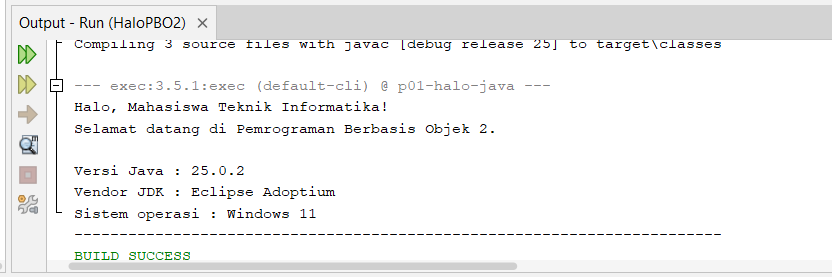
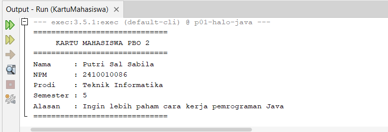

# pbo2-2410010086

## P01 – Pengenalan PBO 2

### 1. Hasil Keluaran Program

#### a. Program HaloPBO2

Program `HaloPBO2` dibuat sebagai latihan awal untuk menampilkan keluaran program Java.

**Screenshot keluaran program:**

#### b. Program KartuMahasiswa

Program `KartuMahasiswa` dibuat untuk menampilkan informasi kartu mahasiswa melalui program Java.

**Screenshot keluaran program:**

### 2. Riwayat Commit Git

Riwayat commit digunakan untuk melihat perubahan yang telah disimpan pada repository.

**Screenshot hasil perintah `git log --oneline`:**

Screenshot menunjukkan riwayat commit repository dengan minimal dua commit.
